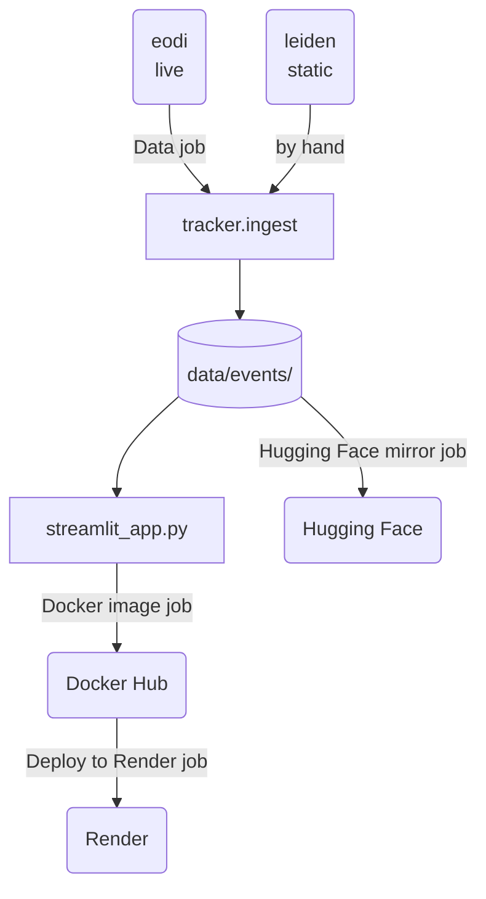
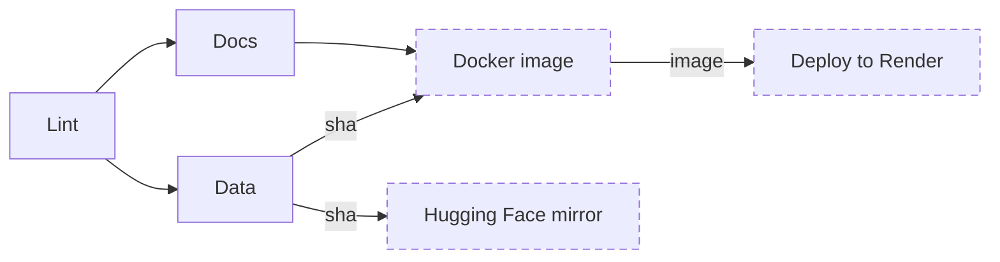
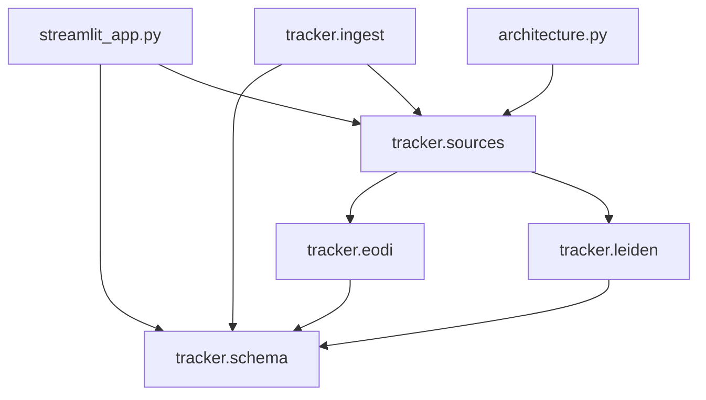

# Architecture

1. Each source module in `src/tracker/` downloads one open dataset and maps it
   to the unified schema.
2. `python -m tracker.ingest` validates the result and stores it as
   `data/events/<source>.csv`, committed to the repository.
3. The Streamlit page `src/streamlit_app.py` reads these files and nothing else.
4. The pipeline refreshes the live sources every day, publishes the app and
   mirrors `data/events/` to a public Hugging Face dataset. The app does not
   read the mirror.

This page is generated from the code by `scripts/architecture.py`: do not edit
it by hand. After a change, run this command and commit the result:

```bash
PYTHONPATH=src python scripts/architecture.py
```

The pipeline fails while the page is out of date.

## Overview

Where the events come from, where they are stored, and where they go. Rounded boxes are outside the repository. Edge labels name the pipeline job or the manual step that moves the data. The Docker image holds `requirements.txt`, `.streamlit/`, `src/`, `data/`.



| Source | Name | Kind | Licence | Stored as |
| --- | --- | --- | --- | --- |
| `eodi` | [European Observatory of Drone Incidents](https://droneobservatory.eu) | live | CC BY 4.0 | `data/events/eodi.csv` |
| `leiden` | [Russian Operations Against Europe Dataset, 2022-2025](https://doi.org/10.7910/DVN/TQ0FMQ) | static | CC BY 4.0 | `data/events/leiden.csv` |

## Pipeline

The jobs of each workflow in `.github/workflows/`. Jobs run from left to right: a job starts when the jobs it needs have passed. Dashed jobs run only when their `if` condition holds. Edge labels name the job outputs that the next job reads. Secrets and variables are set in the repository settings (Secrets and variables, Actions). The steps table leaves out the steps without a name, and shows "a script" for a `run` of several lines.

`pipeline.yml` runs on `push` (`branches: main`), `pull_request`, `schedule` (`cron: 17 4 * * *`), `workflow_dispatch`.



| Job | Runs if | Secrets and variables |
| --- | --- | --- |
| Lint |  |  |
| Data |  |  |
| Docs |  |  |
| Docker image | `github.ref == 'refs/heads/main' && vars.DOCKER_IMAGE != ''` | `DOCKERHUB_TOKEN` (secret), `DOCKER_IMAGE` (variable) |
| Deploy to Render | `needs.image.outputs.image != ''` | `RENDER_DEPLOY_HOOK_URL` (secret) |
| Hugging Face mirror | `github.ref == 'refs/heads/main' && vars.HF_DATASET != ''` | `HF_DATASET` (variable) |

| Job | Step | Runs if | Runs |
| --- | --- | --- | --- |
| Lint | Install |  | `pip install -r requirements-dev.txt` |
| Lint | Lint |  | `ruff check . && ruff format --check .` |
| Data | Install |  | `pip install -r requirements-dev.txt` |
| Data | Refresh live sources | `github.event_name == 'schedule' \|\| github.event_name == 'workflow_dispatch'` | `python -m tracker.ingest live` |
| Data | Validate stored data |  | `python -m tracker.ingest check` |
| Data | Run the tests |  | `pytest` |
| Data | Commit refreshed data | `github.event_name == 'schedule' \|\| github.event_name == 'workflow_dispatch'` | a script |
| Docs | Install |  | `pip install -r requirements-dev.txt -r docs/requirements.txt` |
| Docs | Check the architecture page |  | `python scripts/architecture.py --check` |
| Docs | Build docs |  | `sphinx-build -W --keep-going -b html docs docs/_build/html` |
| Docker image | Publish Docker image |  | a script |
| Deploy to Render | Deploy to Render |  | a script |
| Hugging Face mirror | Install |  | `pip install -r requirements-dev.txt` |
| Hugging Face mirror | Mirror the data to Hugging Face |  | a script |

## Modules

Python files and their imports: an arrow points to the imported module.



| Module | File | Purpose | Third-party imports |
| --- | --- | --- | --- |
| `streamlit_app.py` | `src/streamlit_app.py` | Dashboard: maps and charts of the unified hybrid-incident dataset. | pandas, plotly, pycountry, streamlit |
| `tracker.eodi` | `src/tracker/eodi.py` | European Observatory of Drone Incidents (EODI) - live source. | pandas |
| `tracker.ingest` | `src/tracker/ingest.py` | Fetch sources and store them as data/events/\<source\>.csv. |  |
| `tracker.leiden` | `src/tracker/leiden.py` | Russian Operations Against Europe Dataset (Leiden University) - static source. | pandas, pycountry |
| `tracker.schema` | `src/tracker/schema.py` | Unified event schema shared by every source adapter. | pandas |
| `tracker.sources` | `src/tracker/sources.py` | Registry of data sources and access to their stored events. | pandas |
| `architecture.py` | `scripts/architecture.py` | Generate docs/architecture.md, the architecture diagrams, from the code. | yaml |
