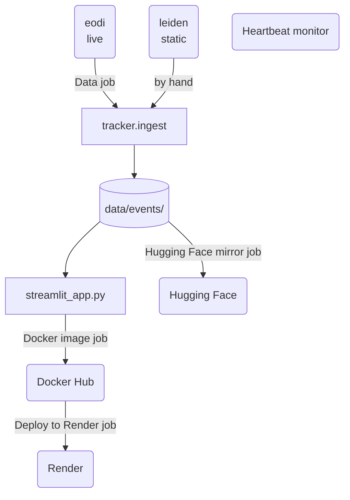
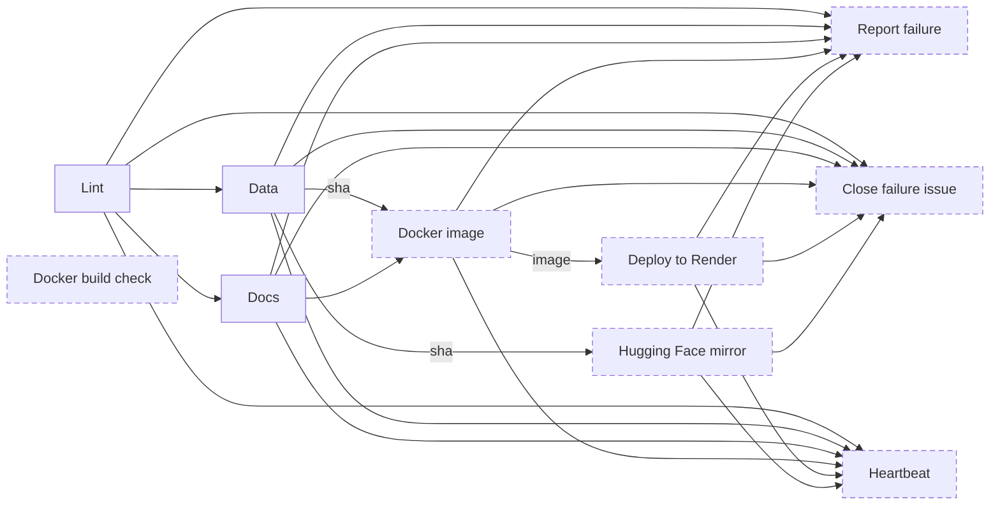
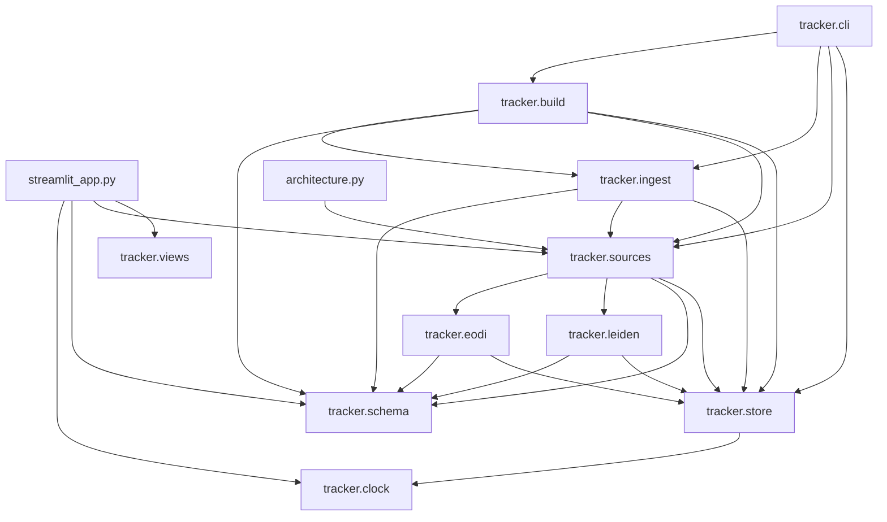

# Architecture

1. Each source module in `src/tracker/` has two steps: `extract()` downloads
   the files of one open dataset, and `normalize()` maps the stored files to
   the unified schema.
2. `tracker ingest` saves the downloaded files in the raw store, validates the
   mapped events and stores them as `data/events/<source>.csv`, committed to
   the repository, and as a clean Parquet table in the raw store.
3. The Streamlit page `src/streamlit_app.py` reads these files and nothing else.
4. The pipeline refreshes the live sources every day, publishes the app and
   mirrors `data/events/` to a public Hugging Face dataset. The app does not
   read the mirror.

This page is generated from the code by `scripts/architecture.py`: do not edit
it by hand. After a change, run this command and commit the result:

```bash
uv run python scripts/architecture.py
```

The pipeline fails while the page is out of date.

## Overview

Where the events come from, where they are stored, and where they go. Rounded boxes are outside the repository. Edge labels name the pipeline job or the manual step that moves the data. The Docker image holds `src/`, `.streamlit/`, `data/`, and the packages of `uv.lock`.



| Source | Name | Kind | Licence | Stored as |
| --- | --- | --- | --- | --- |
| `eodi` | [European Observatory of Drone Incidents](https://droneobservatory.eu) | live | CC BY 4.0 | `data/events/eodi.csv` |
| `leiden` | [Russian Operations Against Europe Dataset, 2022-2025](https://doi.org/10.7910/DVN/TQ0FMQ) | static | CC BY 4.0 | `data/events/leiden.csv` |

## Pipeline

The jobs of each workflow in `.github/workflows/`. Jobs run from left to right: a job starts when the jobs it needs have passed. Dashed jobs run only when their `if` condition holds. Edge labels name the job outputs that the next job reads. Secrets and variables are set in the repository settings (Secrets and variables, Actions). The steps table leaves out the steps without a name, and shows "a script" for a `run` of several lines.

`pipeline.yml` runs on `push` (`branches: main`), `pull_request`, `schedule` (`cron: 17 4 * * *`), `workflow_dispatch`.



| Job | Runs if | Secrets and variables |
| --- | --- | --- |
| Lint |  |  |
| Data |  |  |
| Docs |  |  |
| Docker build check | `github.event_name == 'pull_request'` |  |
| Docker image | `github.ref == 'refs/heads/main' && vars.DOCKER_IMAGE != ''` | `DOCKERHUB_TOKEN` (secret), `DOCKER_IMAGE` (variable) |
| Deploy to Render | `needs.image.outputs.image != ''` | `RENDER_DEPLOY_HOOK_URL` (secret) |
| Hugging Face mirror | `github.ref == 'refs/heads/main' && vars.HF_DATASET != ''` | `HF_DATASET` (variable) |
| Report failure | `failure() && (github.event_name == 'schedule' \|\| github.event_name == 'workflow_dispatch')` |  |
| Close failure issue | `${{ !failure() && !cancelled() && github.event_name == 'schedule' }}` |  |
| Heartbeat | `${{ !failure() && !cancelled() && github.event_name == 'schedule' }}` | `HEARTBEAT_URL` (secret) |

| Job | Step | Runs if | Runs |
| --- | --- | --- | --- |
| Lint | Install |  | `uv sync --locked` |
| Lint | Lint |  | `uv run ruff check . && uv run ruff format --check .` |
| Lint | Type check |  | `uv run --locked mypy` |
| Data | Install |  | `uv sync --locked` |
| Data | Refresh live sources | `github.event_name == 'schedule' \|\| github.event_name == 'workflow_dispatch'` | `uv run tracker ingest live` |
| Data | Build the published tables | `github.event_name == 'schedule' \|\| github.event_name == 'workflow_dispatch'` | `uv run tracker build` |
| Data | Validate stored data |  | `uv run tracker ingest check` |
| Data | Run the tests |  | `uv run pytest --cov --cov-report=term --cov-report=markdown-append:"$GITHUB_STEP_SUMMARY"` |
| Data | Commit refreshed data | `github.event_name == 'schedule' \|\| github.event_name == 'workflow_dispatch'` | a script |
| Docs | Install |  | `uv sync --locked --group docs` |
| Docs | Check the architecture page |  | `uv run python scripts/architecture.py --check` |
| Docs | Build docs |  | `uv run sphinx-build -W --keep-going -b html docs docs/_build/html` |
| Docker build check | Build the image |  | `docker/build-push-action@c3c9e263c25d99ce0380d002d59b67737d91b0dc` |
| Docker build check | Check the user and the health check |  | a script |
| Docker build check | Start the container and wait for the health answer |  | a script |
| Docker image | Name the image and check the registry |  | a script |
| Docker image | Set up Buildx | `steps.image.outputs.published != 'true'` | `docker/setup-buildx-action@f87e5991a6d7451dcb8d9637bfbc97413f497069` |
| Docker image | Build the image for the scan | `steps.image.outputs.published != 'true'` | `docker/build-push-action@c3c9e263c25d99ce0380d002d59b67737d91b0dc` |
| Docker image | Scan the image and write the report | `steps.image.outputs.published != 'true'` | `aquasecurity/trivy-action@ed142fd0673e97e23eac54620cfb913e5ce36c25` |
| Docker image | Add the report to the job summary | `steps.image.outputs.published != 'true'` | a script |
| Docker image | Fail on a critical finding that has a fix | `steps.image.outputs.published != 'true'` | `aquasecurity/trivy-action@ed142fd0673e97e23eac54620cfb913e5ce36c25` |
| Docker image | Publish the image with its provenance | `steps.image.outputs.published != 'true'` | `docker/build-push-action@c3c9e263c25d99ce0380d002d59b67737d91b0dc` |
| Docker image | Attest the build provenance | `steps.image.outputs.published != 'true'` | `actions/attest@1e69f48acb82d1966a394da916b4c1698aa569d6` |
| Docker image | Move latest to the attested image | `steps.image.outputs.published != 'true'` | `docker buildx imagetools create --tag "$DOCKER_IMAGE:latest" "$DOCKER_IMAGE@$DIGEST"` |
| Deploy to Render | Deploy to Render |  | a script |
| Deploy to Render | Wait for the new image to answer | `steps.deploy.outputs.called == 'true'` | a script |
| Hugging Face mirror | Install |  | `uv sync --locked` |
| Hugging Face mirror | Mirror the data to Hugging Face |  | a script |
| Hugging Face mirror | Tag the dataset with the schema version |  | a script |
| Report failure | Open an issue, or comment on the open one |  | a script |
| Close failure issue | Close the open failure issues |  | a script |
| Heartbeat | Ping the heartbeat monitor |  | a script |

## Modules

Python files and their imports: an arrow points to the imported module.



| Module | File | Purpose | Third-party imports |
| --- | --- | --- | --- |
| `streamlit_app.py` | `src/streamlit_app.py` | Dashboard: maps and charts of the unified hybrid-incident dataset. | pandas, plotly, pycountry, streamlit |
| `tracker.build` | `src/tracker/build.py` | Build the published tables from the clean tables of the raw store. | duckdb, pandas, pyarrow |
| `tracker.cli` | `src/tracker/cli.py` | The \`tracker\` command: one subcommand per action. |  |
| `tracker.clock` | `src/tracker/clock.py` | The current day, in UTC like the stored event dates. | pandas |
| `tracker.eodi` | `src/tracker/eodi.py` | European Observatory of Drone Incidents (EODI) - live source. | pandas |
| `tracker.ingest` | `src/tracker/ingest.py` | Download sources, keep their payloads in the raw store and write clean tables. | pandas |
| `tracker.leiden` | `src/tracker/leiden.py` | Russian Operations Against Europe Dataset (Leiden University) - static source. | openpyxl, pandas, pycountry |
| `tracker.schema` | `src/tracker/schema.py` | Unified event schema shared by every source adapter. | pandas |
| `tracker.sources` | `src/tracker/sources.py` | Registry of data sources and access to their stored events. | pandas |
| `tracker.store` | `src/tracker/store.py` | Raw store client: keeps each source payload as fetched, with a manifest. | huggingface_hub |
| `tracker.views` | `src/tracker/views.py` | Filters and headline counts of the dashboard, as plain functions on a frame. | pandas |
| `architecture.py` | `scripts/architecture.py` | Generate docs/architecture.md, the architecture diagrams, from the code. | yaml |
