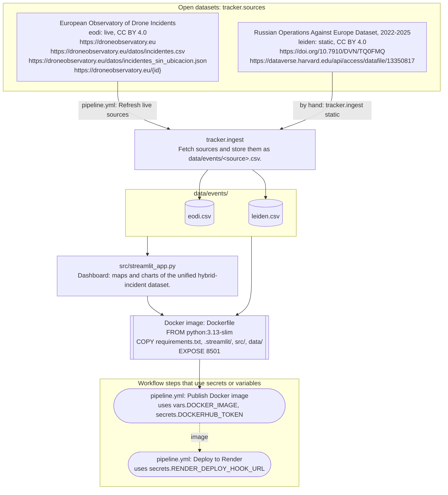
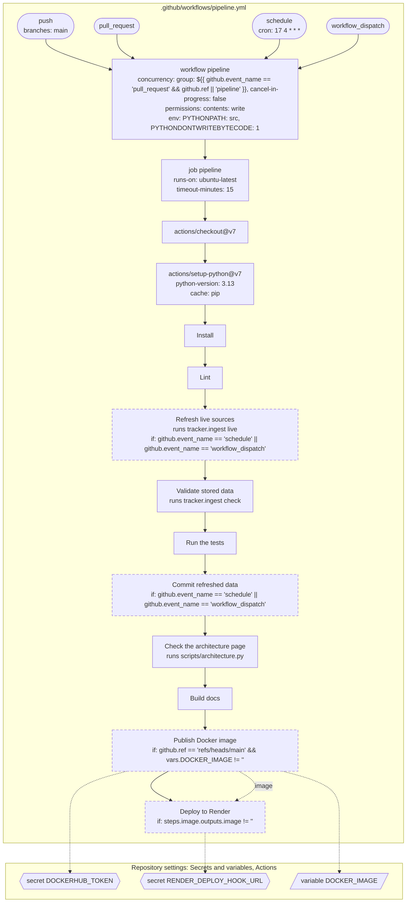
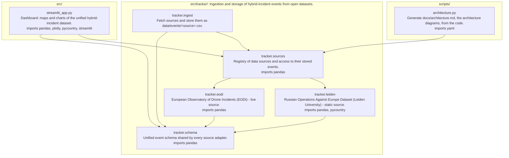

# Architecture

1. Each source module in `src/tracker/` downloads one open dataset and maps it
   to the unified schema.
2. `python -m tracker.ingest` validates the result and stores it as
   `data/events/<source>.csv`, committed to the repository.
3. The Streamlit page `src/streamlit_app.py` reads these files and nothing else.
4. The pipeline refreshes the live sources every day and publishes the app.

This page is generated from the code by `scripts/architecture.py`: do not edit
it by hand. After a change, run this command and commit the result:

```bash
PYTHONPATH=src python scripts/architecture.py
```

The pipeline fails while the page is out of date.

## Overview

Where the events come from, where they are stored, and how the app is published. Edge labels name the workflow steps that do the work.



## Pipeline

Each workflow in `.github/workflows/`: its triggers, settings and jobs, then the steps in order. Dashed steps run only when their `if` condition holds. Dotted arrows point to the secrets and variables a step uses: they are set in the repository settings.



## Modules

Python files and their imports: an arrow points to the imported module. Each box gives the module docstring and its third-party imports.


